# Lifecycles

> Generated by `python scripts/lifecycles.py docs --write`. Do not edit by
> hand: `python scripts/lifecycles.py check` fails when this file is stale.

Every status field this app owns, the states it can hold, and the moves it
declares. 22 lifecycles are registered.

Read one without opening the source:

```bash
python scripts/lifecycles.py list                 # one line per lifecycle
python scripts/lifecycles.py show task            # states + legal moves
python scripts/lifecycles.py show task --json     # for a tool or an agent
python scripts/lifecycles.py mermaid task         # diagram only
```

## Map

| Lifecycle | Initial | Resting | States | Declared in |
|-----------|---------|---------|--------|-------------|
| [`agent_job`](#agent_job) | `queued` | `cancelled`, `failed`, `succeeded` | 5 | `agent/job_manager.py (AgentJob.status)` |
| [`approval_gate`](#approval_gate) | `pending` | `approved`, `rejected` | 3 | `workflow/models.py (ApprovalGate.status)` |
| [`bounty`](#bounty) | `failed` | `declined`, `failed`, `lost`, `paid` | 7 | `packages/bounty/models.py (HuntRecord.state)` |
| [`ceo_attempt`](#ceo_attempt) | `running` | `accepted`, `error`, `rejected` | 4 | `services/ceo_ledger.py (Attempt.status)` |
| [`ceo_goal`](#ceo_goal) | `open` | `abandoned`, `closed` | 3 | `services/ceo_ledger.py (GoalRecord.state)` |
| [`ceo_subtask`](#ceo_subtask) | `pending` | `done` | 4 | `services/ceo_ledger.py (SubtaskRecord.status)` |
| [`direct_chat`](#direct_chat) | `assistant_reply` | `completed` | 6 | `agent/schemas.py (DirectChatState)` |
| [`governance_approval`](#governance_approval) | `pending` | `approved`, `denied`, `expired` | 4 | `packages/governance/approvals.py (ApprovalStatus)` |
| [`heal`](#heal) | `detected` | `awaiting_human`, `resolved` | 6 | `agent/self_healing.py (HealingEvent.state)` |
| [`onboarding`](#onboarding) | `not_started` | `archived`, `cancelled`, `complete` | 10 | `models/company_graph.py (Company.onboarding_status)` |
| [`onboarding_progress`](#onboarding_progress) | `not_started` | `cancelled`, `completed` | 6 | `models/company_graph.py (OnboardingProgress.status)` |
| [`run`](#run) | `created` | `cancelled`, `dead_letter`, `failed`, `succeeded`, `timed_out` | 14 | `packages/runs/store.py (RunRecord.state)` |
| [`scan`](#scan) | `pending` | `failed`, `partial`, `success` | 4 | `models/company_graph.py (Website.scan_status, RepoScanResult.status)` |
| [`spec`](#spec) | `pending` | `approved`, `rejected`, `skipped` | 4 | `services/spec_store.py (spec.status)` |
| [`specialist`](#specialist) | `available` | `disabled` | 4 | `models/company_graph.py (Specialist.status)` |
| [`task`](#task) | `todo` | `done`, `wont_do` | 8 | `tasks/service.py (Task.status)` |
| [`task_queue_job`](#task_queue_job) | `pending` | `cancelled`, `done`, `failed` | 5 | `services/task_queue.py (PrioritizedTask.status)` |
| [`task_workflow_phase`](#task_workflow_phase) | `classify` | `blocked`, `done`, `failed` | 11 | `agent/workflow.py (Task.workflow_phase)` |
| [`workflow_phase`](#workflow_phase) | `pending` | `done`, `failed`, `skipped` | 5 | `workflow/models.py (Phase.status)` |
| [`workflow_run`](#workflow_run) | `pending` | `cancelled`, `done`, `failed` | 13 | `workflow/models.py (WorkflowRun.status)` |
| [`workflow_slice`](#workflow_slice) | `pending` | `applied`, `failed`, `skipped` | 5 | `workflow/models.py (Slice.status)` |
| [`workspace`](#workspace) | `creating` | `archived`, `cancelled`, `cleaned`, `completed`, `failed` | 10 | `workspace/manifest.py (WorkspaceManifest.status)` |

## agent_job

A background agent job: accepted, run, then settled or cancelled.

- **Owner:** `agent/job_manager.py (AgentJob.status)`
- **Initial:** `queued`
- **Resting:** `cancelled`, `failed`, `succeeded`

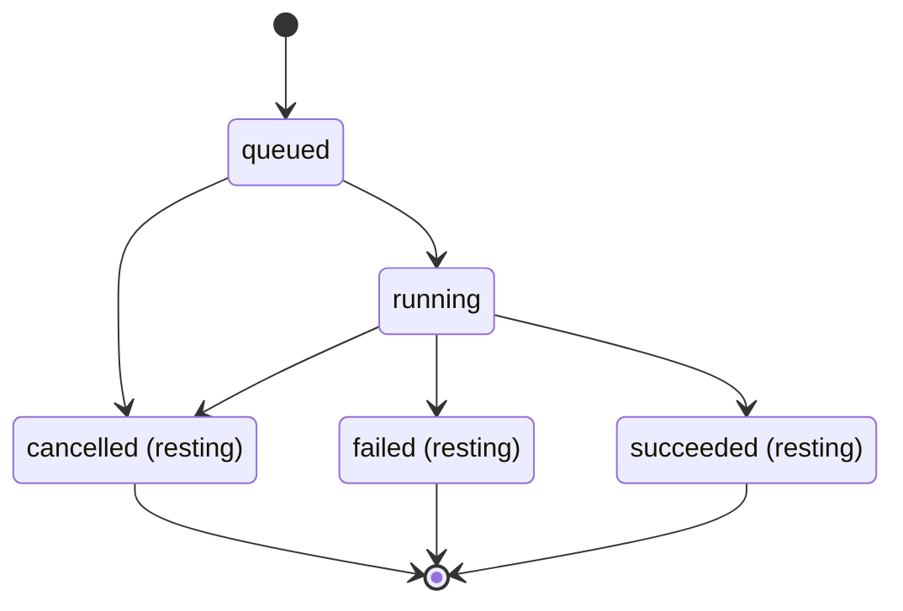

| From | To |
|------|----|
| `cancelled` | — (resting) |
| `failed` | — (resting) |
| `queued` | cancelled, running |
| `running` | cancelled, failed, succeeded |
| `succeeded` | — (resting) |

## approval_gate

The hard human gate between a plan and its execution.

- **Owner:** `workflow/models.py (ApprovalGate.status)`
- **Initial:** `pending`
- **Resting:** `approved`, `rejected`

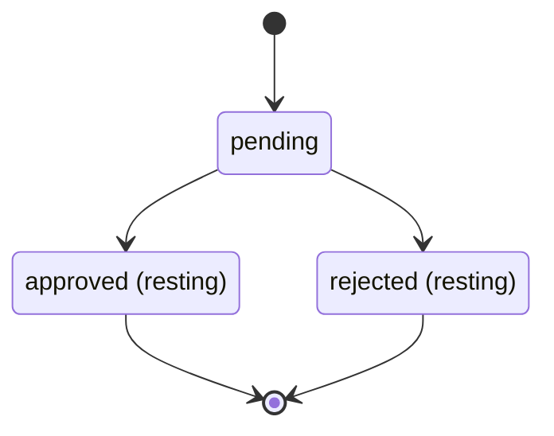

| From | To |
|------|----|
| `approved` | — (resting) |
| `pending` | approved, rejected |
| `rejected` | — (resting) |

## bounty

One bounty attempt: solved and parked for a person to approve, then submitted upstream and swept until merged and paid, or lost.

- **Owner:** `packages/bounty/models.py (HuntRecord.state)`
- **Status type:** `packages.bounty.models:BountyState`
- **Initial:** `failed`
- **Resting:** `declined`, `failed`, `lost`, `paid`
- **Notes:**
  - attempt() creates the record as FAILED and only a successful publish moves it to awaiting-review; every failure keeps the initial value.
  - Nothing is submitted upstream until the operator approves the tracking issue.
- **No incoming edge from the initial state:** `awaiting-review`, `declined`, `lost`, `merged`, `paid`, `submitted` (written by a dedicated path or legacy data)

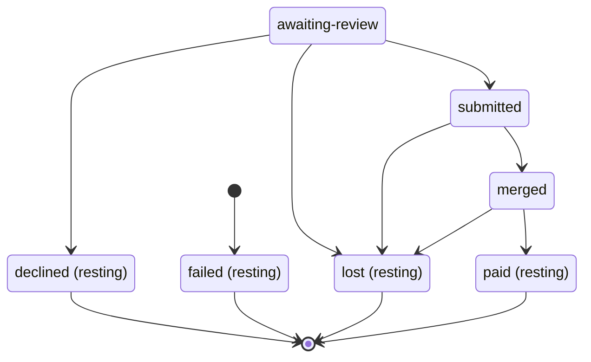

| From | To |
|------|----|
| `awaiting-review` | declined, lost, submitted |
| `declined` | — (resting) |
| `failed` | — (resting) |
| `lost` | — (resting) |
| `merged` | lost, paid |
| `paid` | — (resting) |
| `submitted` | lost, merged |

## ceo_attempt

One delegation of one subtask to one model tier.

- **Owner:** `services/ceo_ledger.py (Attempt.status)`
- **Initial:** `running`
- **Resting:** `accepted`, `error`, `rejected`

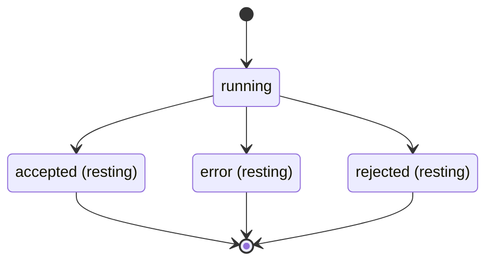

| From | To |
|------|----|
| `accepted` | — (resting) |
| `error` | — (resting) |
| `rejected` | — (resting) |
| `running` | accepted, error, rejected |

## ceo_goal

A goal the CEO has taken ownership of. Only the 24x7 supervisor abandons one; a failed drive leaves the goal open for it to re-drive.

- **Owner:** `services/ceo_ledger.py (GoalRecord.state)`
- **Initial:** `open`
- **Resting:** `abandoned`, `closed`
- **Notes:**
  - ABANDONED is deliberately distinct from CLOSED so a failure is never presented as success.

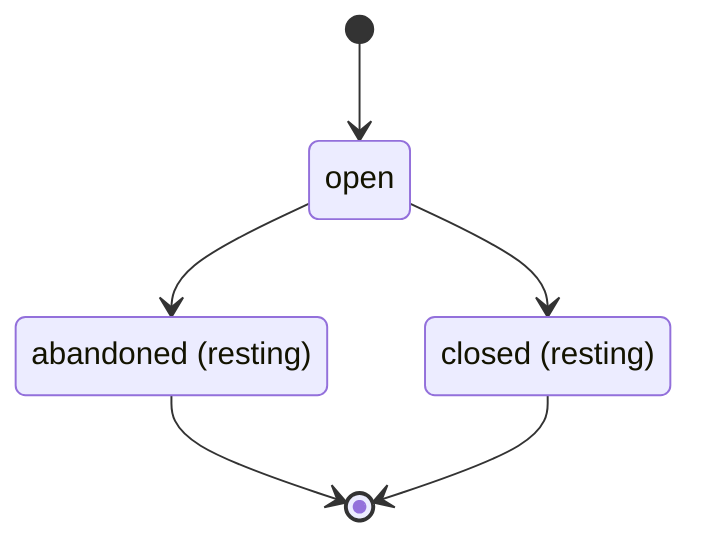

| From | To |
|------|----|
| `abandoned` | — (resting) |
| `closed` | — (resting) |
| `open` | abandoned, closed |

## ceo_subtask

One delegated piece of a CEO goal, with every attempt recorded.

- **Owner:** `services/ceo_ledger.py (SubtaskRecord.status)`
- **Initial:** `pending`
- **Resting:** `done`
- **Notes:**
  - A failed subtask is retried on a supervisor re-drive, hence failed -> running.

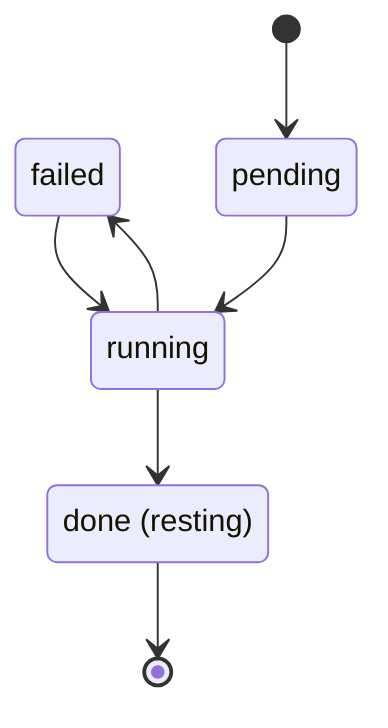

| From | To |
|------|----|
| `done` | — (resting) |
| `failed` | running |
| `pending` | running |
| `running` | done, failed |

## direct_chat

What the direct-chat surface shows the user while an agent job is running. It is a view over agent_job, not a second job record.

- **Owner:** `agent/schemas.py (DirectChatState)`
- **Status type:** `agent.schemas:DirectChatState`
- **Initial:** `assistant_reply`
- **Resting:** `completed`
- **Notes:**
  - direct_chat.py maps job running -> working, succeeded -> completed, failed -> failed_with_fix_hint.

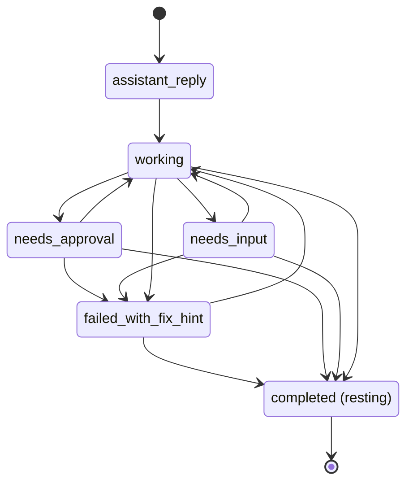

| From | To |
|------|----|
| `assistant_reply` | working |
| `completed` | — (resting) |
| `failed_with_fix_hint` | completed, working |
| `needs_approval` | completed, failed_with_fix_hint, working |
| `needs_input` | completed, failed_with_fix_hint, working |
| `working` | completed, failed_with_fix_hint, needs_approval, needs_input |

## governance_approval

A human decision on a high-risk agent action. Waiting is bounded: an unanswered request expires, and expiry denies.

- **Owner:** `packages/governance/approvals.py (ApprovalStatus)`
- **Status type:** `packages.governance.approvals:ApprovalStatus`
- **Initial:** `pending`
- **Resting:** `approved`, `denied`, `expired`

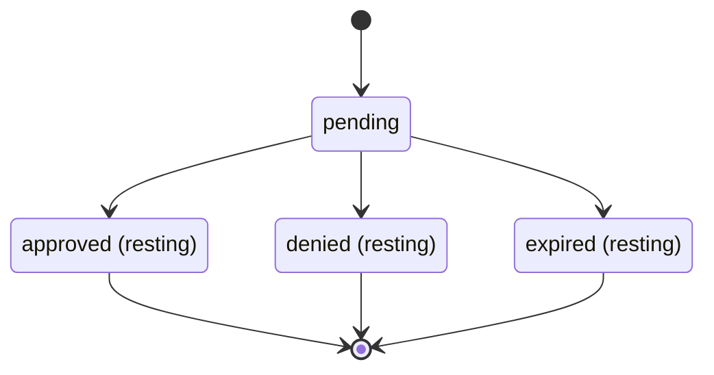

| From | To |
|------|----|
| `approved` | — (resting) |
| `denied` | — (resting) |
| `expired` | — (resting) |
| `pending` | approved, denied, expired |

## heal

A CI failure or bug report driven from detection to a fix that survives a quiet verification window, or escalated to a person.

- **Owner:** `agent/self_healing.py (HealingEvent.state)`
- **Status type:** `agent.self_healing:HealState`
- **Initial:** `detected`
- **Resting:** `awaiting_human`, `resolved`
- **Notes:**
  - A recurrence during verification marks the heal REGRESSED and re-fixes it until HEAL_MAX_ATTEMPTS, then escalates.

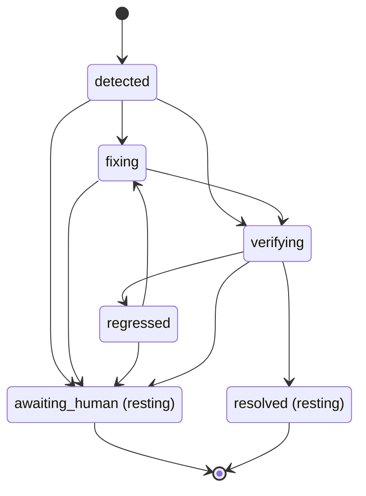

| From | To |
|------|----|
| `awaiting_human` | — (resting) |
| `detected` | awaiting_human, fixing, verifying |
| `fixing` | awaiting_human, verifying |
| `regressed` | awaiting_human, fixing |
| `resolved` | — (resting) |
| `verifying` | awaiting_human, regressed, resolved |

## onboarding

A company's onboarding: create, scan websites and repos, detect systems, provision specialists, activate the agency.

- **Owner:** `models/company_graph.py (Company.onboarding_status)`
- **Initial:** `not_started`
- **Resting:** `archived`, `cancelled`, `complete`
- **Notes:**
  - services/onboarding.py writes in_progress, scanning, detected, configured, paused, failed, cancelled and complete as the run advances, and the progress view reports scanning/detected/configured as in_progress at that phase.
  - 'archived' is legacy data from an earlier deploy, repaired by self_bootstrap.

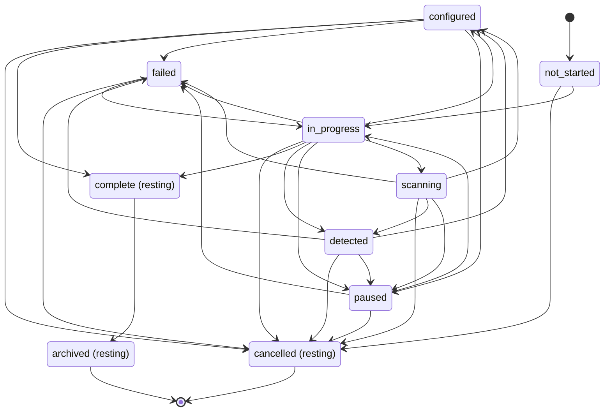

| From | To |
|------|----|
| `archived` | — (resting) |
| `cancelled` | — (resting) |
| `complete` | archived |
| `configured` | cancelled, complete, failed, paused |
| `detected` | cancelled, configured, failed, paused |
| `failed` | cancelled, in_progress |
| `in_progress` | cancelled, complete, configured, detected, failed, paused, scanning |
| `not_started` | cancelled, in_progress |
| `paused` | cancelled, failed, in_progress |
| `scanning` | cancelled, configured, detected, failed, paused |

## onboarding_progress

The API-facing progress view for onboarding. Its vocabulary differs from Company.onboarding_status ('completed' vs 'complete'), deliberately, so the two must be read through their own types.

- **Owner:** `models/company_graph.py (OnboardingProgress.status)`
- **Initial:** `not_started`
- **Resting:** `cancelled`, `completed`

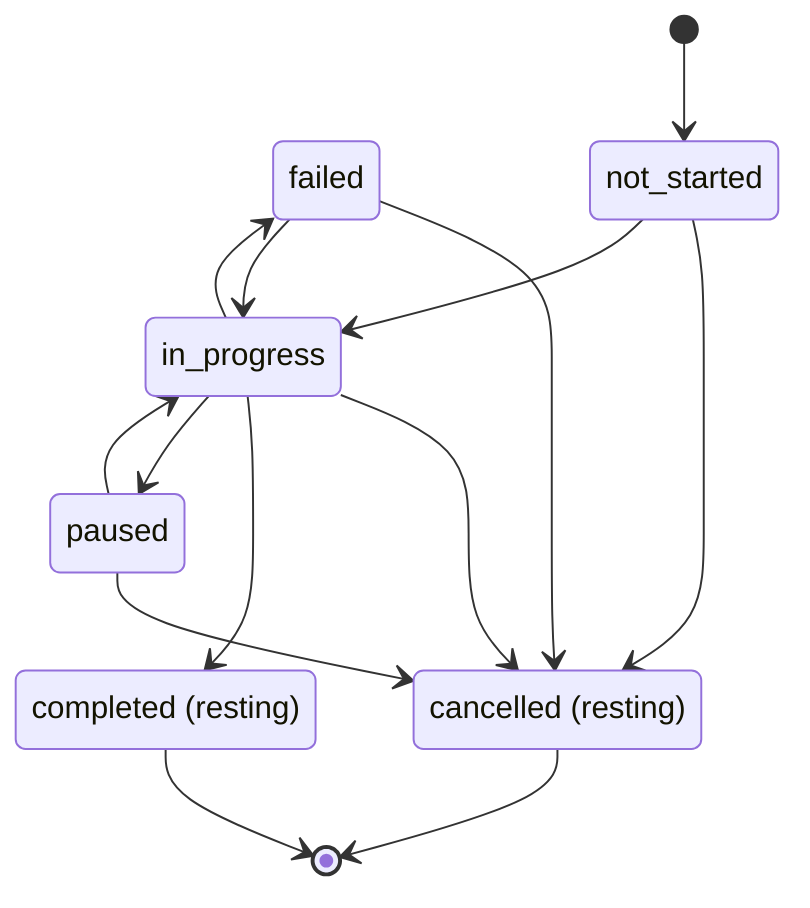

| From | To |
|------|----|
| `cancelled` | — (resting) |
| `completed` | — (resting) |
| `failed` | cancelled, in_progress |
| `in_progress` | cancelled, completed, failed, paused |
| `not_started` | cancelled, in_progress |
| `paused` | cancelled, in_progress |

## run

A durable run of a task or orchestrator workflow: queued, started under a lease, waiting on children or a person, verified, and settled. A run whose lease expired is recovered before it may continue.

- **Owner:** `packages/runs/store.py (RunRecord.state)`
- **Status type:** `packages.runs.models:RunState`
- **Initial:** `created`
- **Resting:** `cancelled`, `dead_letter`, `failed`, `succeeded`, `timed_out`
- **Notes:**
  - Every non-terminal state may move to recovering (its lease expired), cancelled, timed_out or failed.
  - recovering resumes as queued, or parks in waiting_for_approval when a side effect's outcome is unknown (reason uncertain_side_effect).
  - A retry of a terminal run is a new run linked by retry_of, not a move out of a resting state; failed and timed_out may only move on to dead_letter.

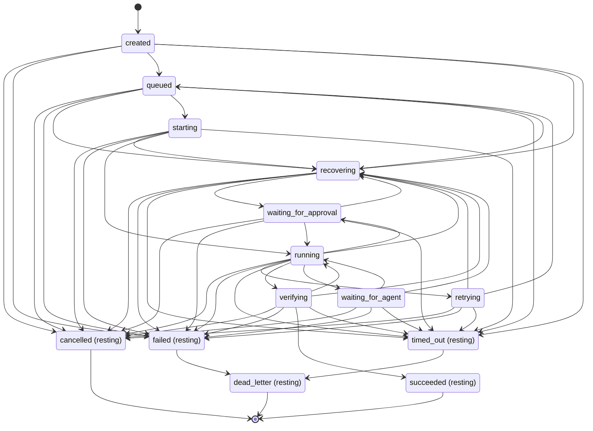

| From | To |
|------|----|
| `cancelled` | — (resting) |
| `created` | cancelled, failed, queued, recovering, timed_out |
| `dead_letter` | — (resting) |
| `failed` | dead_letter |
| `queued` | cancelled, failed, recovering, starting, timed_out |
| `recovering` | cancelled, failed, queued, timed_out, waiting_for_approval |
| `retrying` | cancelled, failed, queued, recovering, timed_out |
| `running` | cancelled, failed, recovering, retrying, timed_out, verifying, waiting_for_agent, waiting_for_approval |
| `starting` | cancelled, failed, recovering, running, timed_out |
| `succeeded` | — (resting) |
| `timed_out` | dead_letter |
| `verifying` | cancelled, failed, recovering, running, succeeded, timed_out |
| `waiting_for_agent` | cancelled, failed, recovering, running, timed_out |
| `waiting_for_approval` | cancelled, failed, recovering, running, timed_out |

## scan

A website or repository scan. 'partial' means enough was detected to be useful and the gaps are reported in errors.

- **Owner:** `models/company_graph.py (Website.scan_status, RepoScanResult.status)`
- **Initial:** `pending`
- **Resting:** `failed`, `partial`, `success`

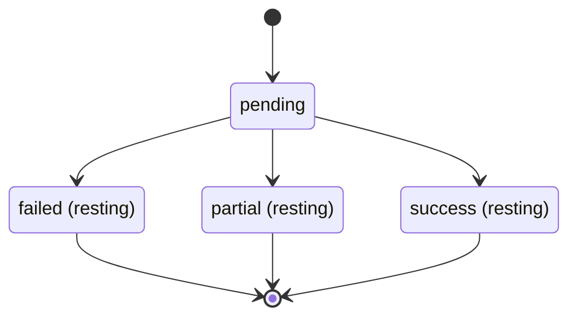

| From | To |
|------|----|
| `failed` | — (resting) |
| `partial` | — (resting) |
| `pending` | failed, partial, success |
| `success` | — (resting) |

## spec

A reviewable plan spec. Runs are auto-approved unless AGENT_SPEC_APPROVAL_REQUIRED is on, in which case execution waits here.

- **Owner:** `services/spec_store.py (spec.status)`
- **Initial:** `pending`
- **Resting:** `approved`, `rejected`, `skipped`
- **Notes:**
  - set_spec_status validates the status name but not the move, so it can re-decide an already-decided spec.
  - A fresh spec is created already approved unless AGENT_SPEC_APPROVAL_REQUIRED is on, so 'pending' is the initial state only in that mode.

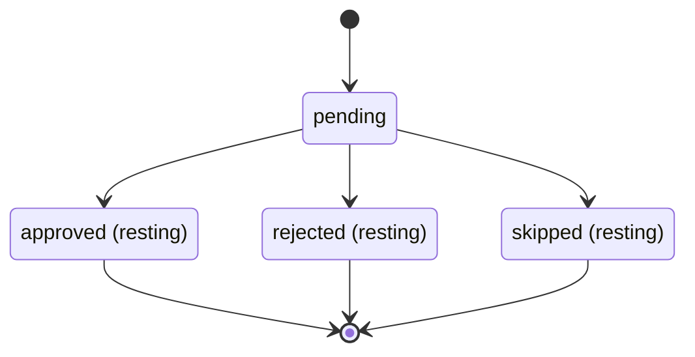

| From | To |
|------|----|
| `approved` | — (resting) |
| `pending` | approved, rejected, skipped |
| `rejected` | — (resting) |
| `skipped` | — (resting) |

## specialist

Whether a provisioned specialist can take work. Readers filter on these four values; no single writer owns the transitions.

- **Owner:** `models/company_graph.py (Specialist.status)`
- **Initial:** `available`
- **Resting:** `disabled`
- **Notes:**
  - Provisioning writes 'available'; company/agency code filters available, busy and disabled. The moves marked here are the field's intent, not an enforced transition table.

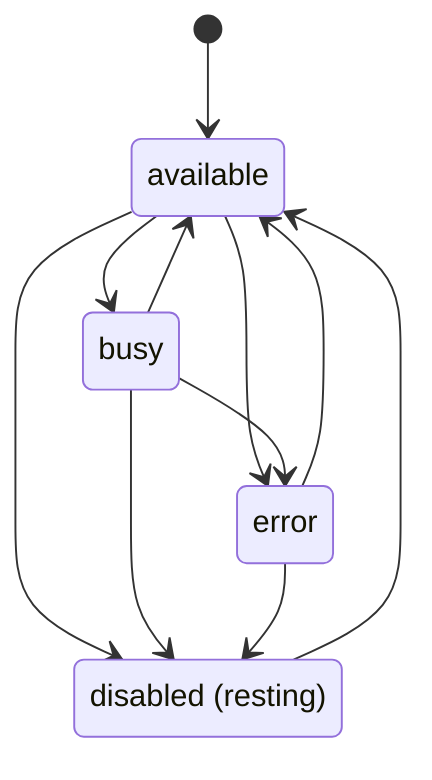

| From | To |
|------|----|
| `available` | busy, disabled, error |
| `busy` | available, disabled, error |
| `disabled` | available |
| `error` | available, disabled |

## task

A task's visible status, from creation through execution and review to a resting outcome. DONE and WONT_DO are resting states with an explicit re-open edge because Retry must always work.

- **Owner:** `tasks/service.py (Task.status)`
- **Status type:** `tasks.models:TaskStatus`
- **Initial:** `todo`
- **Resting:** `done`, `wont_do`
- **Notes:**
  - WONT_DO means a person declined the work; it must not read as FAILED.
  - ALLOWED_TRANSITIONS in tasks/service.py is derived from this declaration.
  - needs_clarification has no incoming edge: tasks/api.py writes the field directly in clarify_task (see "Clarifying a task bypasses its legal-transition table").
- **No incoming edge from the initial state:** `needs_clarification` (written by a dedicated path or legacy data)

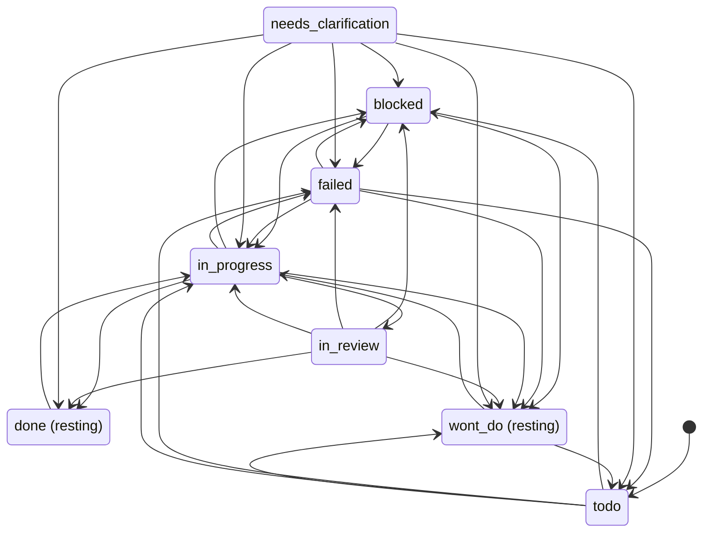

| From | To |
|------|----|
| `blocked` | failed, in_progress, wont_do |
| `done` | in_progress |
| `failed` | blocked, in_progress, todo, wont_do |
| `in_progress` | blocked, done, failed, in_review, wont_do |
| `in_review` | blocked, done, failed, in_progress, wont_do |
| `needs_clarification` | blocked, done, failed, in_progress, todo, wont_do |
| `todo` | blocked, failed, in_progress, wont_do |
| `wont_do` | in_progress, todo |

## task_queue_job

A queued background task executed by the in-process worker pool.

- **Owner:** `services/task_queue.py (PrioritizedTask.status)`
- **Initial:** `pending`
- **Resting:** `cancelled`, `done`, `failed`

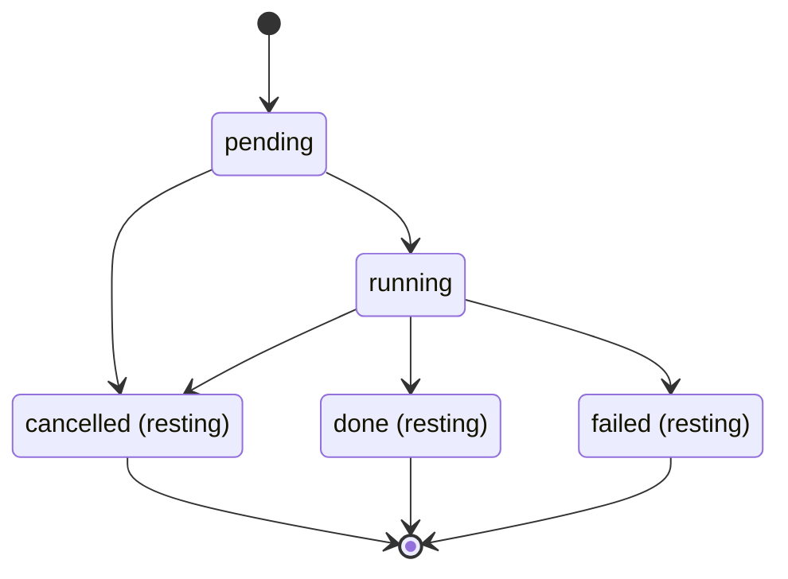

| From | To |
|------|----|
| `cancelled` | — (resting) |
| `done` | — (resting) |
| `failed` | — (resting) |
| `pending` | cancelled, running |
| `running` | cancelled, done, failed |

## task_workflow_phase

The persisted phase of a task's execution pipeline, written to the task store before each advance so a crash resumes at a known phase.

- **Owner:** `agent/workflow.py (Task.workflow_phase)`
- **Status type:** `agent.workflow:WorkflowPhase`
- **Initial:** `classify`
- **Resting:** `blocked`, `done`, `failed`
- **Notes:**
  - Any phase becomes FAILED on an exception; preflight alone can BLOCK.
  - This is a second, independent notion of done/failed/blocked on the same task as Task.status (see "One task carries two independent lifecycle phases").

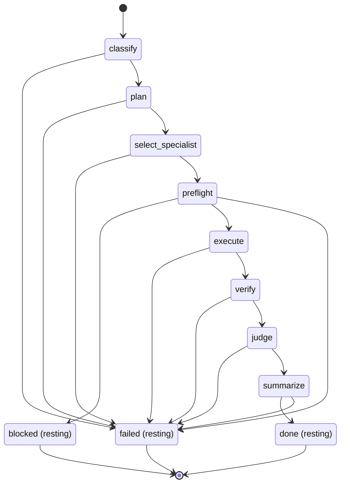

| From | To |
|------|----|
| `blocked` | — (resting) |
| `classify` | failed, plan |
| `done` | — (resting) |
| `execute` | failed, verify |
| `failed` | — (resting) |
| `judge` | failed, summarize |
| `plan` | failed, select_specialist |
| `preflight` | blocked, execute, failed |
| `select_specialist` | failed, preflight |
| `summarize` | done, failed |
| `verify` | failed, judge |

## workflow_phase

One named phase inside a workflow run.

- **Owner:** `workflow/models.py (Phase.status)`
- **Status type:** `workflow.models:PhaseStatus`
- **Initial:** `pending`
- **Resting:** `done`, `failed`, `skipped`
- **Notes:**
  - 'skipped' is declared but no writer in workflow/ sets it.

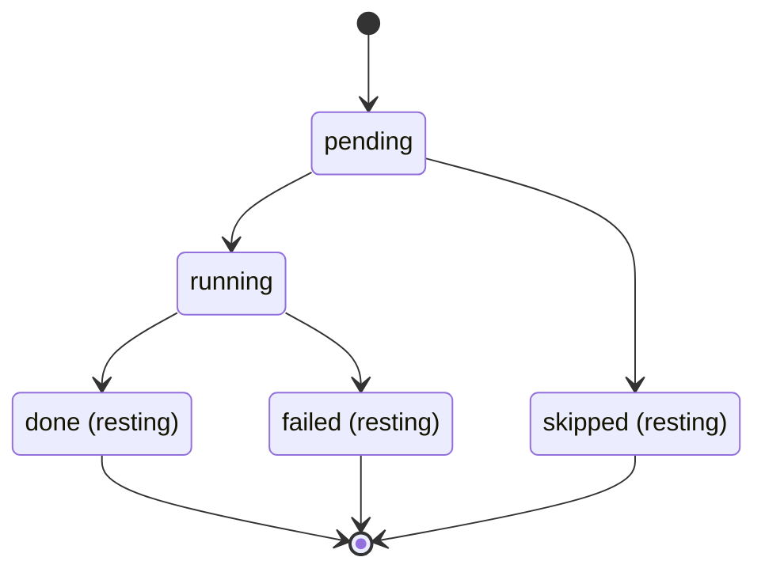

| From | To |
|------|----|
| `done` | — (resting) |
| `failed` | — (resting) |
| `pending` | running, skipped |
| `running` | done, failed |
| `skipped` | — (resting) |

## workflow_run

A CRISPY build run: pre-gate phases, the hard human approval gate, then slice execution and a final report.

- **Owner:** `workflow/models.py (WorkflowRun.status)`
- **Status type:** `workflow.models:WorkflowStatus`
- **Initial:** `pending`
- **Resting:** `cancelled`, `done`, `failed`
- **Notes:**
  - The gate is mandatory: only approve() moves awaiting_approval to executing.
  - The engine sets reviewing and verifying around each slice's review and verify stages, then returns to executing; the post-gate 'report' phase does not change the run status.
  - done -> executing re-runs a slice with force; failed -> executing resumes a failed run.

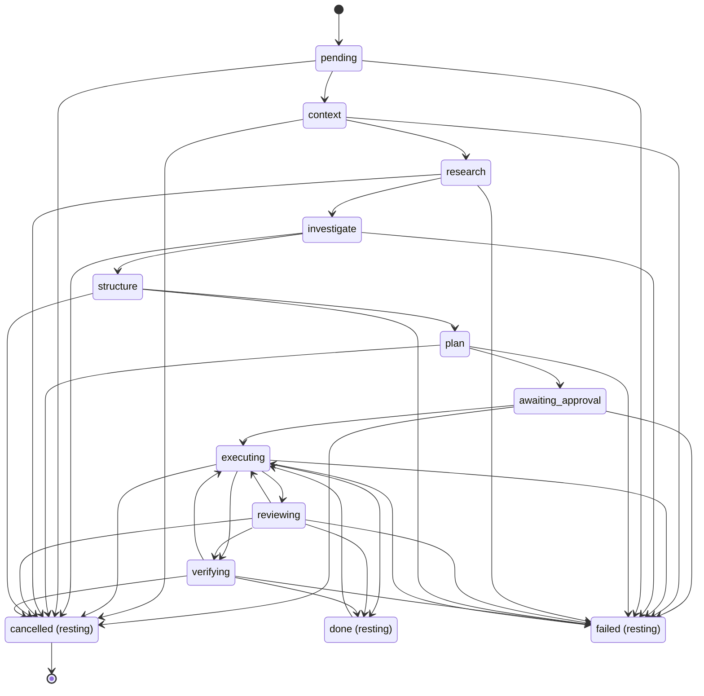

| From | To |
|------|----|
| `awaiting_approval` | cancelled, executing, failed |
| `cancelled` | — (resting) |
| `context` | cancelled, failed, research |
| `done` | executing |
| `executing` | cancelled, done, failed, reviewing, verifying |
| `failed` | executing |
| `investigate` | cancelled, failed, structure |
| `pending` | cancelled, context, failed |
| `plan` | awaiting_approval, cancelled, failed |
| `research` | cancelled, failed, investigate |
| `reviewing` | cancelled, done, executing, failed, verifying |
| `structure` | cancelled, failed, plan |
| `verifying` | cancelled, done, executing, failed |

## workflow_slice

One independently deliverable slice: execute, review, verify, then applied or failed. A forced re-run moves an applied slice back to running.

- **Owner:** `workflow/models.py (Slice.status)`
- **Status type:** `workflow.models:SliceStatus`
- **Initial:** `pending`
- **Resting:** `applied`, `failed`, `skipped`
- **Notes:**
  - 'skipped' is declared but no writer in workflow/ sets it.

```mermaid
stateDiagram-v2
    state "applied (resting)" as s_applied
    state "failed (resting)" as s_failed
    state "pending" as s_pending
    state "running" as s_running
    state "skipped (resting)" as s_skipped
    [*] --> s_pending
    s_applied --> s_running
    s_pending --> s_running
    s_pending --> s_skipped
    s_running --> s_applied
    s_running --> s_failed
    s_failed --> [*]
    s_skipped --> [*]
```

| From | To |
|------|----|
| `applied` | running |
| `failed` | — (resting) |
| `pending` | running, skipped |
| `running` | applied, failed |
| `skipped` | — (resting) |

## workspace

An isolated agent workspace: created, activated, optionally paused, then completed/failed/cancelled, archived and eventually cleaned.

- **Owner:** `workspace/manifest.py (WorkspaceManifest.status)`
- **Status type:** `agent.workspace:WorkspaceStatus`
- **Initial:** `creating`
- **Resting:** `archived`, `cancelled`, `cleaned`, `completed`, `failed`
- **Notes:**
  - archive() and cleanup are guarded by CLEANABLE_STATES; pause/complete/fail/cancel accept any current status.
  - agent/workspace.py imports RESUMABLE_STATES and ACTIVE_STATES from this module, so both managers answer resume and cleanup questions identically.

```mermaid
stateDiagram-v2
    state "active" as s_active
    state "archived (resting)" as s_archived
    state "cancelled (resting)" as s_cancelled
    state "cancelling" as s_cancelling
    state "cleaned (resting)" as s_cleaned
    state "completed (resting)" as s_completed
    state "creating" as s_creating
    state "failed (resting)" as s_failed
    state "paused" as s_paused
    state "ready" as s_ready
    [*] --> s_creating
    s_active --> s_cancelling
    s_active --> s_completed
    s_active --> s_failed
    s_active --> s_paused
    s_archived --> s_cleaned
    s_cancelled --> s_archived
    s_cancelled --> s_cleaned
    s_cancelling --> s_cancelled
    s_cancelling --> s_failed
    s_completed --> s_archived
    s_completed --> s_cleaned
    s_creating --> s_cancelling
    s_creating --> s_failed
    s_creating --> s_ready
    s_failed --> s_archived
    s_failed --> s_cleaned
    s_paused --> s_active
    s_paused --> s_cancelling
    s_paused --> s_completed
    s_paused --> s_failed
    s_ready --> s_active
    s_ready --> s_cancelling
    s_ready --> s_completed
    s_ready --> s_failed
    s_cleaned --> [*]
```

| From | To |
|------|----|
| `active` | cancelling, completed, failed, paused |
| `archived` | cleaned |
| `cancelled` | archived, cleaned |
| `cancelling` | cancelled, failed |
| `cleaned` | — (resting) |
| `completed` | archived, cleaned |
| `creating` | cancelling, failed, ready |
| `failed` | archived, cleaned |
| `paused` | active, cancelling, completed, failed |
| `ready` | active, cancelling, completed, failed |

## Findings

### 1. One task carries two independent lifecycle phases

`Task.status` (todo/in_progress/.../done) and `Task.workflow_phase` (classify/plan/.../done/failed/blocked) both describe where a task is, both have a `done`, a `failed` and a `blocked`, and they are written by different components. A reader must consult both to answer "what is this task doing?", and they can disagree (status IN_REVIEW while the workflow phase is DONE). No change here; the mapping makes the dual state explicit.

Lifecycles: `task`, `task_workflow_phase`

### 2. Clarifying a task bypasses its legal-transition table

`tasks/api.py` sets `task.status = TaskStatus.NEEDS_CLARIFICATION` directly, and no state in `ALLOWED_TRANSITIONS` has needs_clarification as a target. The state is therefore reachable only through that endpoint, and the transition guard cannot check the move. Kept as-is for behaviour compatibility; recorded so the next change to the task lifecycle does not assume every state has an incoming edge.

Lifecycles: `task`
